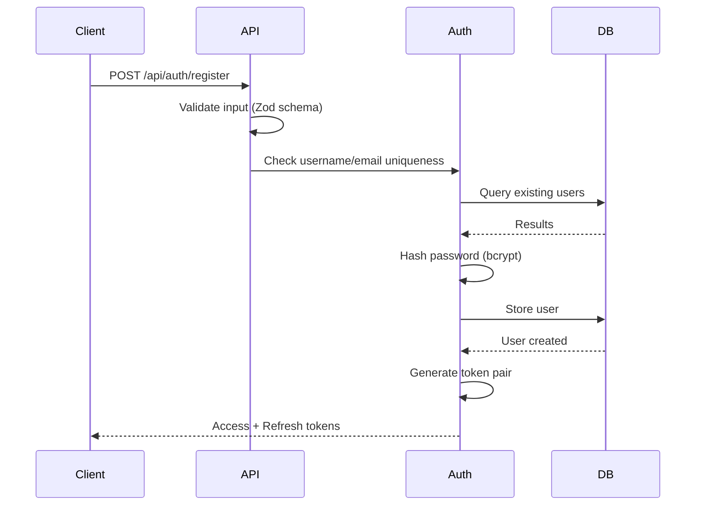
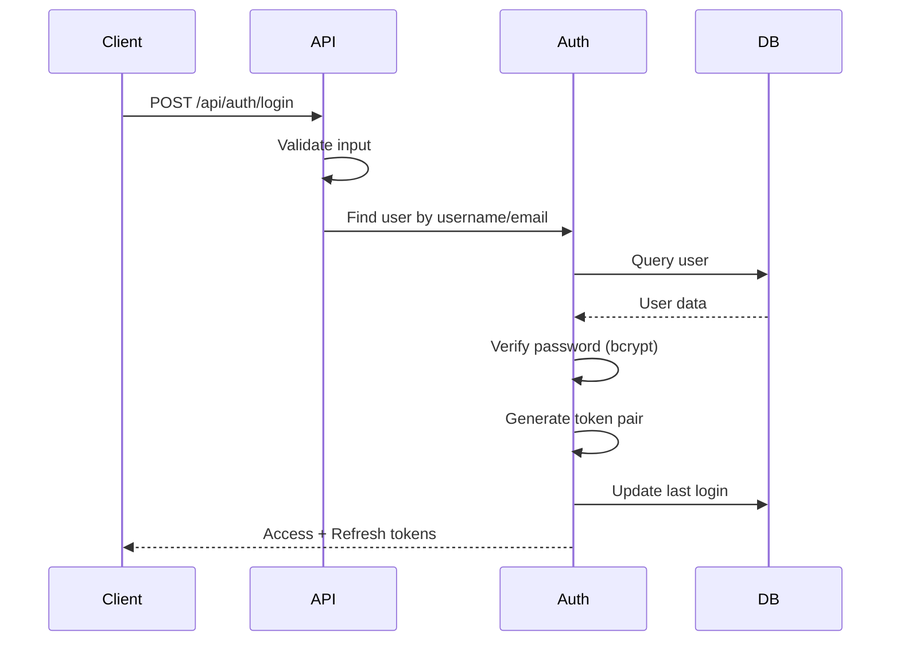
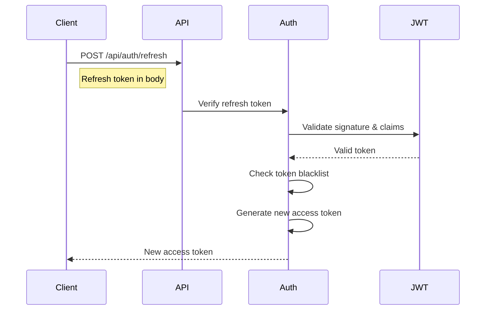
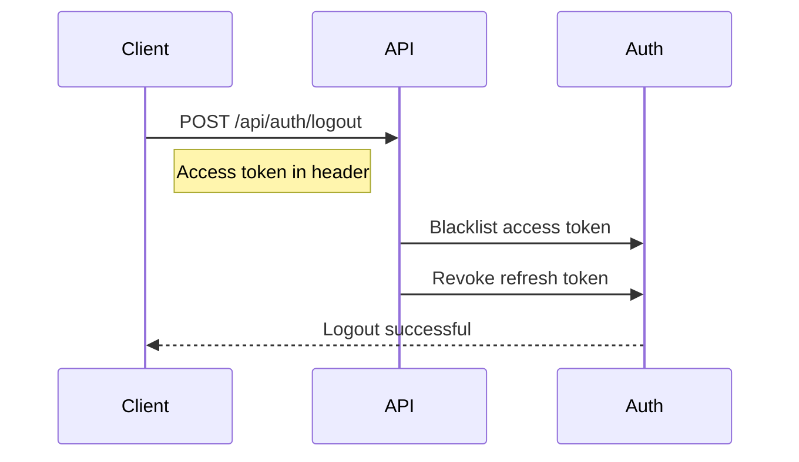

# Authentication & Security Guide

## Overview

The Civilization Game API implements enterprise-grade security with JWT-based authentication, comprehensive rate limiting, and multiple security layers. This guide covers all authentication flows, security measures, and best practices.

## Authentication Architecture

### JWT Token System

The API uses a dual-token authentication system:

1. **Access Token** (Short-lived: 15 minutes)
   - Used for API authentication
   - Contains user identity and basic claims
   - Automatically rotated with secure key management

2. **Refresh Token** (Long-lived: 7 days)
   - Used to obtain new access tokens
   - Stored securely on client
   - Can be revoked for enhanced security

### Token Structure

#### Access Token Claims
```json
{
  "userId": "550e8400-e29b-41d4-a716-446655440000",
  "username": "player123",
  "iat": 1642248000,
  "exp": 1642248900,
  "aud": "civilization-game-client",
  "iss": "civilization-game-server",
  "jti": "access_1642248000_abc123"
}
```

#### Refresh Token Claims
```json
{
  "userId": "550e8400-e29b-41d4-a716-446655440000",
  "username": "player123",
  "type": "refresh",
  "iat": 1642248000,
  "exp": 1642852800,
  "aud": "civilization-game-client",
  "iss": "civilization-game-server",
  "jti": "refresh_1642248000_def456"
}
```

## Authentication Flows

### User Registration



#### Registration Request
```bash
curl -X POST http://localhost:3001/api/auth/register \
  -H "Content-Type: application/json" \
  -d '{
    "username": "player123",
    "email": "player@example.com",
    "password": "SecurePass123!"
  }'
```

#### Registration Response
```json
{
  "success": true,
  "message": "User registered successfully",
  "user": {
    "id": "550e8400-e29b-41d4-a716-446655440000",
    "username": "player123",
    "email": "player@example.com",
    "createdAt": "2024-01-15T10:30:00Z",
    "gamesPlayed": 0,
    "gamesWon": 0
  },
  "token": "eyJhbGciOiJIUzI1NiIsInR5cCI6IkpXVCJ9...",
  "refreshToken": "eyJhbGciOiJIUzI1NiIsInR5cCI6IkpXVCJ9..."
}
```

### User Login



#### Login Request
```bash
curl -X POST http://localhost:3001/api/auth/login \
  -H "Content-Type: application/json" \
  -d '{
    "username": "player123",
    "password": "SecurePass123!"
  }'
```

### Token Refresh Flow



#### Token Refresh Request
```bash
curl -X POST http://localhost:3001/api/auth/refresh \
  -H "Content-Type: application/json" \
  -d '{
    "refreshToken": "eyJhbGciOiJIUzI1NiIsInR5cCI6IkpXVCJ9..."
  }'
```

#### Token Refresh Response
```json
{
  "accessToken": "eyJhbGciOiJIUzI1NiIsInR5cCI6IkpXVCJ9...",
  "expiresIn": "15m"
}
```

### Logout Flow



## Security Headers

### Automatic Security Headers

The API automatically applies comprehensive security headers:

```http
X-Content-Type-Options: nosniff
X-Frame-Options: DENY
X-XSS-Protection: 1; mode=block
Referrer-Policy: strict-origin-when-cross-origin
Permissions-Policy: geolocation=(), microphone=(), camera=()
Content-Security-Policy: default-src 'self'; script-src 'self' 'unsafe-inline'; style-src 'self' 'unsafe-inline'; connect-src 'self' ws: wss:; img-src 'self' data: https:; font-src 'self';
```

### CORS Configuration

```javascript
// CORS Settings
{
  origin: 'http://localhost:5173', // Client URL
  credentials: false,              // No cookies by default
  methods: ['GET', 'POST', 'PUT', 'DELETE'],
  allowedHeaders: ['Content-Type', 'Authorization'],
  maxAge: 86400                    // 24 hours cache
}
```

## Rate Limiting

### Three-Tier Rate Limiting System

#### 1. Authentication Endpoints (Strict)
- **Limit**: 5 requests per 5 minutes
- **Block Duration**: 15 minutes
- **Endpoints**: `/api/auth/login`, `/api/auth/register`

```http
GET /api/auth/login
X-RateLimit-Limit: 5
X-RateLimit-Remaining: 3
X-RateLimit-Reset: 2024-01-15T10:35:00Z
```

#### 2. General API Endpoints (Standard)
- **Limit**: 100 requests per 15 minutes
- **Block Duration**: 5 minutes
- **Endpoints**: All `/api/*` endpoints except auth

#### 3. Sensitive Endpoints (Ultra-Strict)
- **Limit**: 2 requests per 10 minutes
- **Block Duration**: 30 minutes
- **Endpoints**: Password reset, security changes

### Rate Limit Headers

All responses include rate limiting information:

```http
X-RateLimit-Limit: 100
X-RateLimit-Remaining: 85
X-RateLimit-Reset: 2024-01-15T10:45:00Z
Retry-After: 300
```

### Rate Limit Exceeded Response

```json
{
  "error": "Rate limit exceeded",
  "message": "Too many requests from this IP",
  "retryAfter": 300,
  "limit": 100,
  "window": "15 minutes"
}
```

## Input Validation & Sanitization

### Comprehensive Input Validation

All inputs are validated using Zod schemas with automatic sanitization:

#### Password Requirements
```javascript
const passwordSchema = z.string()
  .min(8, 'Password must be at least 8 characters')
  .max(128, 'Password too long')
  .regex(
    /^(?=.*[a-z])(?=.*[A-Z])(?=.*\d)(?=.*[@$!%*?&])[A-Za-z\d@$!%*?&]/,
    'Password must contain uppercase, lowercase, number, and special character'
  );
```

#### Username Validation
```javascript
const usernameSchema = z.string()
  .min(3, 'Username must be at least 3 characters')
  .max(20, 'Username must be at most 20 characters')
  .regex(/^[a-zA-Z0-9_-]+$/, 'Username can only contain letters, numbers, underscores, and hyphens')
  .transform(val => val.toLowerCase().trim());
```

### Request Sanitization

Automatic sanitization removes:
- Null bytes (`\0`)
- HTML/JavaScript injection attempts  
- Excessive whitespace
- Malformed Unicode

### Validation Error Response

```json
{
  "success": false,
  "error": "Validation failed",
  "details": [
    {
      "field": "body.password",
      "message": "Password must contain at least one uppercase letter",
      "code": "invalid_string"
    },
    {
      "field": "body.email",
      "message": "Invalid email format",
      "code": "invalid_string"
    }
  ]
}
```

## Password Security

### Bcrypt Hashing

Passwords are hashed using bcrypt with configurable rounds:

```javascript
// Development: 12 rounds (fast)
// Production: 14+ rounds (secure)
const hashedPassword = await bcrypt.hash(password, config.BCRYPT_ROUNDS);
```

### Password Policy

- **Minimum Length**: 8 characters
- **Maximum Length**: 128 characters
- **Required Elements**:
  - At least one lowercase letter
  - At least one uppercase letter
  - At least one digit
  - At least one special character (@$!%*?&)

## JWT Security

### Secure JWT Implementation

#### Key Management
- **Development**: Auto-generated 512-bit keys
- **Production**: Externally provided secure keys
- **Key Rotation**: Automatic every 24 hours
- **Key Storage**: In-memory with secure generation

#### Token Security Features
- **Audience Validation**: Ensures tokens are for correct service
- **Issuer Validation**: Prevents token reuse across services
- **JTI (JWT ID)**: Unique token identifier for revocation
- **Short Expiration**: 15-minute access tokens minimize exposure
- **Secure Algorithms**: Only HMAC SHA-256 or RSA with SHA-256

#### Token Blacklisting

```javascript
// Blacklist token on logout or security event
await secureJWTManager.blacklistToken(token, 'User logout');

// Verify token is not blacklisted
const decoded = await secureJWTManager.verify(token);
```

### JWT Best Practices Implementation

1. **Short-Lived Access Tokens** - Minimize exposure window
2. **Secure Refresh Strategy** - Separate refresh token validation
3. **Automatic Token Rotation** - Fresh tokens on each refresh
4. **Revocation Support** - Immediate token invalidation
5. **Audience/Issuer Claims** - Prevent cross-service token reuse

## Secure WebSocket Authentication

### Connection Authentication

WebSockets don't support headers after connection, so authentication uses:

1. **Initial Connection**: JWT token in connection query
2. **Per-Action Auth**: Player ID validation for each game action
3. **Connection Recovery**: Re-authentication on reconnect

### WebSocket Security Features

```javascript
// Connection with authentication
const socket = io('ws://localhost:3001', {
  auth: {
    token: localStorage.getItem('accessToken')
  }
});

// Server-side validation
socket.on('game_action', (data) => {
  if (!validatePlayerInGame(data.playerId, data.gameId)) {
    socket.emit('error', { message: 'Unauthorized action' });
    return;
  }
  // Process action...
});
```

## Environment Security

### Development vs Production

#### Development Environment
```javascript
// Auto-generated secrets (insecure but convenient)
JWT_SECRET=<auto-generated>
BCRYPT_ROUNDS=12
ENABLE_DEBUG_ENDPOINTS=true
BYPASS_RATE_LIMITING=false
```

#### Production Environment
```javascript
// Mandatory secure configuration
JWT_SECRET=<512-bit-secure-key>
JWT_REFRESH_SECRET=<different-512-bit-key>
BCRYPT_ROUNDS=14
ENABLE_DEBUG_ENDPOINTS=false
ENABLE_SECURITY_HEADERS=true
```

### Configuration Validation

```javascript
// Production security checks
if (config.NODE_ENV === 'production') {
  const checks = [
    { check: process.env.JWT_SECRET, message: 'JWT_SECRET required in production' },
    { check: process.env.DATABASE_URL, message: 'DATABASE_URL required in production' },
    { check: config.JWT_SECRET.length >= 32, message: 'JWT_SECRET too short for production' }
  ];
  
  const failedChecks = checks.filter(check => !check.check);
  if (failedChecks.length > 0) {
    throw new Error('Production security validation failed');
  }
}
```

## API Security Middleware Stack

### Request Processing Order

1. **Security Headers** - Apply security headers
2. **CORS** - Cross-origin request validation  
3. **Rate Limiting** - Request frequency control
4. **Request Sanitization** - Input cleaning
5. **Body Parsing** - JSON parsing with size limits
6. **Input Validation** - Schema validation
7. **Authentication** - JWT token verification
8. **Authorization** - Permission checking
9. **Route Handler** - Business logic execution
10. **Error Handling** - Consistent error responses

### Middleware Configuration

```javascript
// Security middleware stack
app.use(securityHeaders());
app.use(helmet({
  contentSecurityPolicy: {
    directives: {
      defaultSrc: ['\'self\''],
      connectSrc: ['\'self\'', 'ws:', 'wss:'],
      scriptSrc: ['\'self\'', '\'unsafe-inline\''],
      styleSrc: ['\'self\'', '\'unsafe-inline\''],
      imgSrc: ['\'self\'', 'data:', 'https:'],
      fontSrc: ['\'self\'']
    }
  }
}));
app.use(cors(corsConfig));
app.use(rateLimiter.apiRateLimit());
app.use(sanitizeRequest());
app.use(express.json({ limit: '1mb' }));
app.use(validateRequest(schema));
app.use(authenticateToken);
```

## Client-Side Security Best Practices

### Token Storage

```javascript
// Secure token storage
class TokenManager {
  constructor() {
    this.accessToken = null;
    this.refreshToken = null;
  }
  
  setTokens(access, refresh) {
    this.accessToken = access;
    // Store refresh token securely (httpOnly cookie preferred)
    localStorage.setItem('refreshToken', refresh);
  }
  
  getAccessToken() {
    return this.accessToken;
  }
  
  clearTokens() {
    this.accessToken = null;
    localStorage.removeItem('refreshToken');
  }
}
```

### Automatic Token Refresh

```javascript
// HTTP interceptor for automatic token refresh
axios.interceptors.response.use(
  (response) => response,
  async (error) => {
    if (error.response?.status === 401 && 
        error.response?.data?.code === 'TOKEN_EXPIRED') {
      
      try {
        const newToken = await refreshAccessToken();
        // Retry original request with new token
        error.config.headers.Authorization = `Bearer ${newToken}`;
        return axios.request(error.config);
      } catch (refreshError) {
        // Redirect to login if refresh fails
        window.location.href = '/login';
      }
    }
    return Promise.reject(error);
  }
);
```

### Secure API Requests

```javascript
// Secure API request wrapper
async function secureApiCall(endpoint, options = {}) {
  const token = tokenManager.getAccessToken();
  
  const config = {
    ...options,
    headers: {
      'Content-Type': 'application/json',
      'Authorization': token ? `Bearer ${token}` : undefined,
      ...options.headers
    }
  };
  
  try {
    const response = await fetch(endpoint, config);
    
    if (response.status === 401) {
      await handleTokenRefresh();
      // Retry with new token
      config.headers.Authorization = `Bearer ${tokenManager.getAccessToken()}`;
      return await fetch(endpoint, config);
    }
    
    return response;
  } catch (error) {
    console.error('API call failed:', error);
    throw error;
  }
}
```

## Security Monitoring & Alerting

### Security Events Logged

1. **Authentication Events**
   - Failed login attempts
   - Account lockouts
   - Token refresh failures
   - Suspicious login patterns

2. **Authorization Events**
   - Unauthorized access attempts
   - Permission escalation attempts
   - Invalid game actions

3. **Rate Limiting Events**
   - Rate limit violations
   - Potential DDoS attempts
   - Unusual traffic patterns

4. **Input Validation Events**
   - Malicious input attempts
   - Injection attack attempts
   - Invalid data submissions

### Log Format

```javascript
{
  "timestamp": "2024-01-15T10:30:00Z",
  "level": "SECURITY",
  "event": "FAILED_LOGIN_ATTEMPT",
  "userId": "attempted_user_id",
  "ip": "192.168.1.100",
  "userAgent": "Mozilla/5.0...",
  "details": {
    "username": "admin",
    "attemptCount": 5,
    "blocked": true
  }
}
```

## Compliance & Standards

### Security Standards Compliance

- **OWASP Top 10** - Protection against common vulnerabilities
- **JWT Best Practices** - RFC 7519 compliance
- **HTTP Security Headers** - OWASP recommended headers
- **Input Validation** - Comprehensive sanitization and validation
- **Rate Limiting** - Protection against abuse and DDoS

### Data Protection

- **Password Hashing** - Industry-standard bcrypt
- **Token Security** - Secure generation and validation
- **No Sensitive Data Logging** - Passwords and tokens excluded from logs
- **Secure Development** - Security-first development practices

This comprehensive security implementation provides enterprise-grade protection while maintaining usability and performance.